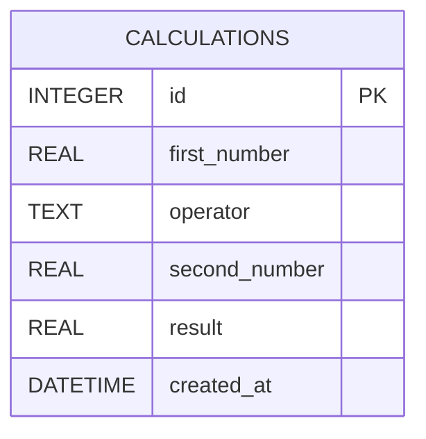

# Data model — overview

> **Sources** — interview Q6, Q14; spec `Documentation/project_documentation.md` §5
> **Status** — [spec]
> **Page-size budget** — used 44 / 150 lines

<a id="tables"></a>
## Tables

| Table | Purpose | Page |
|---|---|---|
| `calculations` | one stored arithmetic operation and its result | [calculations.md](calculations.md) |

<a id="er"></a>
## Entity relationship



Single table — no foreign keys.

<a id="conventions"></a>
## Conventions
- Primary key: `INTEGER PRIMARY KEY AUTOINCREMENT` (SQLite rowid alias).
- Numbers: `REAL`.
- Timestamps: `DATETIME`, default `CURRENT_TIMESTAMP` (UTC).
- Schema source: [calculations.md#schema](calculations.md#schema).

<a id="verify"></a>
## Verify

```bash
git grep --untracked -n "CREATE TABLE" -- docs/wiki/data ":(exclude)docs/wiki/data/00-overview.md"
```
Expected (not run: not a Git repository yet): the `calculations` CREATE TABLE statement on `calculations.md`.
